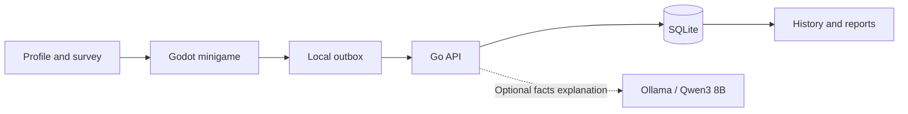

<div align="center">


# ZUMA

### A local workspace for wellbeing checks and cognitive games

**Godot desktop app · Go API · SQLite · Optional local AI**

[Get started](#quick-start) · [Games](#four-games-one-workflow) · [Architecture](docs/architecture.md) · [API](server/docs/openapi.yaml) · [Build for Windows](#windows-build) · [Presentation](https://docs.google.com/presentation/d/1oFyLNCexba2ybygzsPalQympIT0nYYsWJ-4rvEwf87M/edit?usp=sharing)


</div>

---

Zuma is a desktop prototype inspired by the **NASA Space Apps health monitoring challenge**. Record sleep, fatigue, stress, and mood; complete a short game; then review saved results and comparable earlier attempts. The application runs locally after its dependencies are installed. Qwen3 8B through Ollama adds optional explanations of server-calculated facts.

> **Project status:** experimental prototype. The games and reports are not clinically validated and do not diagnose conditions or replace medical care. No wearable or heart-rate integration is included.

## What you can do

- **Track wellbeing** with profiles and saved survey drafts.
- **Play four games** with randomized layouts or questions and three difficulty levels.
- **Keep completed attempts** in a local outbox and retry failed uploads.
- **Explore history and trends**, grouped by compatible games and protocols.
- **Open JSON or printable HTML reports** with calculated results and earlier comparisons when available.
- **Request a local AI explanation** while retaining the numerical report when the model is unavailable.
- **Reuse the minigame module** in another Godot application.

## Four games, one workflow

| Game | Task | Interaction |
| --- | --- | --- |
| **Fifteen Puzzle** | Arrange the numbered tiles in order | Slide a tile into the empty space |
| **Find the Pair** | Remember the revealed cards and match every pair | Select two cards at a time |
| **Speed Math** | Solve arithmetic expressions against the clock | Choose one of four answers |
| **Remember the Numbers** | Remember the positions and select numbers in order | Select the numbered positions after they hide |

**Controls:** `R` restarts, `Esc` returns, and `1`–`4` select Speed Math answers. Losing window focus interrupts the attempt. Rules are shown before play.



The Go server validates game events and calculates measures. The model does not perform the numerical calculations. Legacy reaction and memory sessions remain a separate protocol.

## Quick start

### 1. Get the project

```bash
git clone https://github.com/Mickoki/zuma-health.git
cd zuma-health
```

Requires **Godot 4.7 Standard** and **Go 1.26+**. Python 3 is used by integration tests. Windows is the tested packaging target.

### 2. Start the API

```bash
cd server
go run ./cmd/zuma
```

The API listens at `http://127.0.0.1:8080`. It does not serve a web application at `/`. SQLite is created automatically at `./data/zuma.db`, relative to the server's working directory.

### 3. Open the desktop app

Open the repository's `project.godot` in Godot and press **F5**. Create or select a profile, complete and save the survey, then choose a game. Update the saved survey when wellbeing changes: each new attempt includes its latest saved snapshot.

### Optional: enable local explanations

Install Ollama separately, then download the model:

```bash
ollama pull qwen3:8b
```

Keep Ollama running and request an explanation from a report. The main workflow works without it. Model weights and Ollama are not bundled with Zuma.

## Windows build

Install the matching Godot export templates, then run from the repository root:

```powershell
./scripts/build-windows.ps1 -Godot 'C:\path\to\godot.exe'
```

| Output | Purpose |
| --- | --- |
| `dist/windows/Zuma.exe` | Desktop application |
| `dist/windows/zuma-server.exe` | Local API server |
| `dist/Zuma-Windows.zip` | Package with both executables and license notices |

Extract the ZIP, start `zuma-server.exe`, then start `Zuma.exe`. Close an older server before starting another on the same port. Builds are unsigned. To build the standalone minigame demo, use `scripts/build-minigames.ps1`.

## Data and configuration

Data stays in local SQLite storage and Godot's application user directory. Drafts and queued results are stored on the client. Local data is **not encrypted**.

Server configuration includes `ZUMA_ADDR`, `ZUMA_DB`, `ZUMA_OLLAMA_URL`, and `ZUMA_MODEL`; see the [server configuration reference](server/README.md). Stop the server and back up the database before updating. An older binary may not support a migrated database.

## Repository map

| Path | Contents |
| --- | --- |
| [`addons/zuma_minigames/`](addons/zuma_minigames/) | Portable games, rules, shared theme, icons, and tests |
| [`scripts/`](scripts/) · [`scenes/`](scenes/) | Desktop interface, integration, and build scripts |
| [`server/`](server/) | Go API, validation, SQLite storage, reports, and model adapter |
| [`tests/`](tests/) | Client and integration checks |
| [`docs/`](docs/) | Architecture, verification, and integration guides |
| [`third_party/`](third_party/) | Dependency licenses and notices |

Generated files in `.godot/`, `builds/`, and `dist/` are ignored. User databases, model weights, and local settings should stay outside version control and release archives.

## Verification

```bash
cd server
go test -count=1 ./...
go vet ./...
```

The [testing guide](docs/testing.md) covers client checks, game rules, export validation, real-server integration, and optional model tests. Integration checks use synthetic profiles and disposable data.

## Documentation

- [Architecture](docs/architecture.md)
- [Server setup and configuration](server/README.md)
- [OpenAPI contract](server/docs/openapi.yaml) and [minigame protocol](server/docs/minigames.md)
- [Embed the Godot module](addons/zuma_minigames/README.md)
- [Legacy game integration](docs/game-integration.md)
- [Research background](RESEARCH.md) and [Space Apps project description](docs/space-apps-submission-en.md)

## License

Zuma's own code is released under the [MIT License](LICENSE). Third-party components retain their own licenses; see [third-party notices](third_party/README.md). Ollama and Qwen are separately installed components with their own terms.
